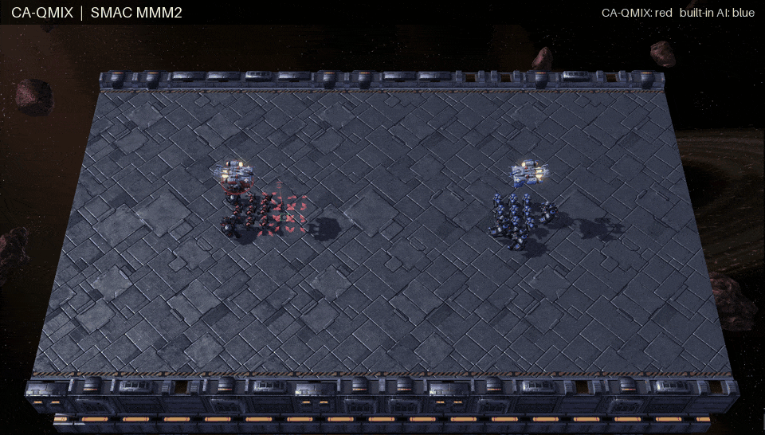
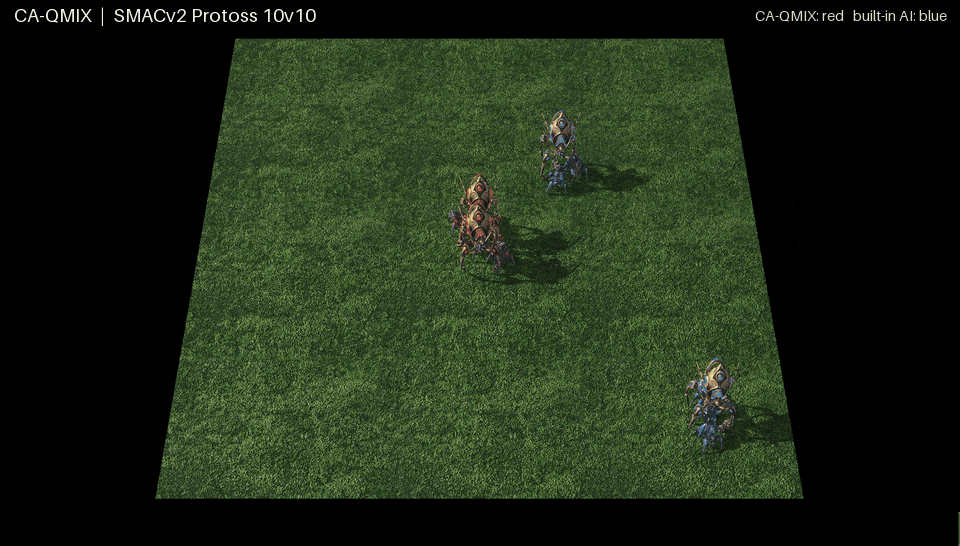

# CA-QMIX

Code for **CA-QMIX** from *Context-Aware Cooperative Gating for Knowledge-Controlled Value Factorization in Multi-Agent Reinforcement Learning*, Seungwoo Jang and Ji Hyun Nam (IJSEKE, to appear).

<p align="center">
  
  
</p>

| Directory | Benchmark | Based on |
|---|---|---|
| `pymarl/` | SMAC | [PyMARL2](https://github.com/hijkzzz/pymarl2) |
| `di-engine/` | SMACv2 | [DI-engine](https://github.com/opendilab/DI-engine) v0.5.3 |

Both contain CA-QMIX and the baselines QMIX, VDN, QTRAN, QPLEX, Qatten and CollaQ.

## Installation

Linux, Python 3.10 (tested with PyTorch 2.7.1).

```bash
conda create -n caqmix python=3.10 -y
conda activate caqmix
pip install torch                  # pick the build for your CUDA version: https://pytorch.org
pip install -r requirements.txt
pip install -e di-engine
bash install_sc2.sh                # StarCraft II 4.10 and the SMAC / SMACv2 maps
export SC2PATH=$HOME/StarCraftII
```

## SMAC

```bash
cd pymarl
python src/main.py --config=caqmix --env-config=sc2 with env_args.map_name=3s5z seed=0
```

- `--config`: `caqmix`, `qmix`, `vdn`, `qtran`, `qplex`, `qatten`, `collaq`
- Maps in the paper: `3s5z`, `2c_vs_64zg`, `10m_vs_11m`, `MMM2`
- Ablations: `with ablation=<name>` (`alpha_none`, `binary_gate`, `delta_q_none`, `no_hard_mask`, `no_vis_input`, `shuffled_vis`)
- 2.05M environment steps with 8 parallel environments. Results are written to `pymarl/results/`.

## SMACv2

```bash
cd di-engine
python train.py --race protoss --method caqmix --seed 0
```

- `--race`: `protoss`, `terran`, `zerg` (10 vs 10)
- `--method`: `caqmix`, `qmix`, `vdn`, `qtran`, `qplex`, `qatten`, `collaq`
- `--ablation`: `alpha_none`, `binary_gate`, `delta_q_none`, `no_hard_mask`, `no_vis_input`, `shuffled_vis`
- 10M environment steps with 8 collector and 8 evaluator environments. Logs and checkpoints are written to `smac2_<race>_<method>_seed<seed>/`.

## License

Apache License 2.0. `pymarl/` and `di-engine/` contain modified code from PyMARL2 and DI-engine; see [NOTICE](NOTICE).
